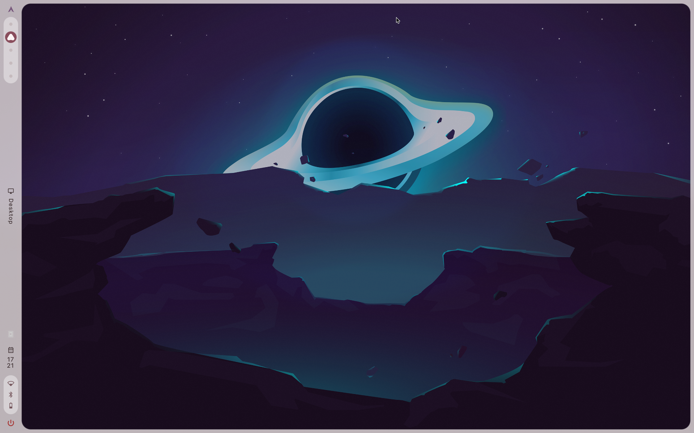
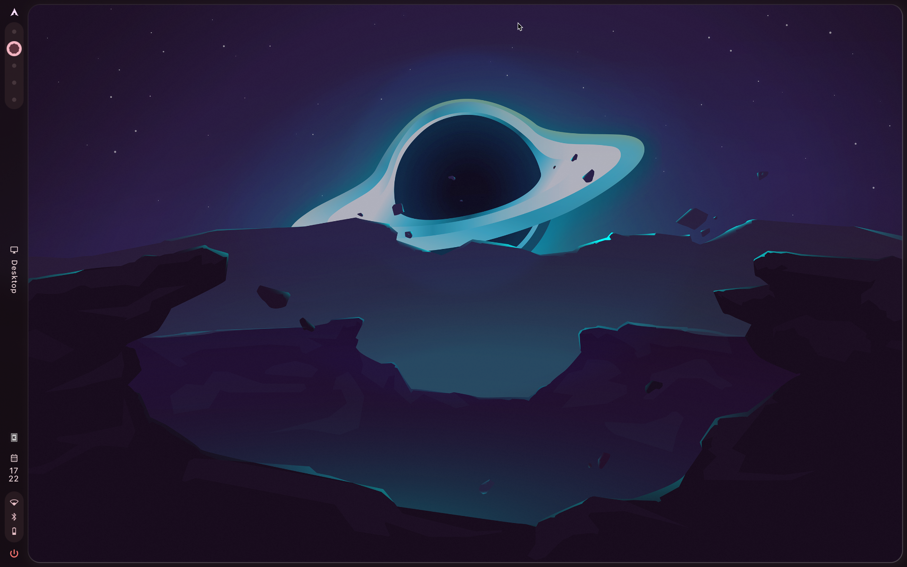
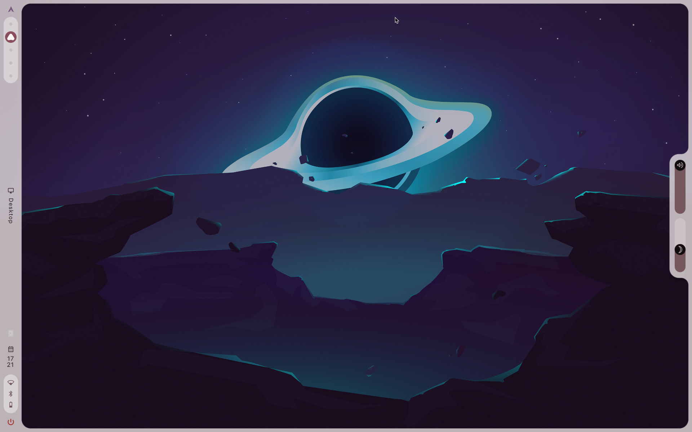
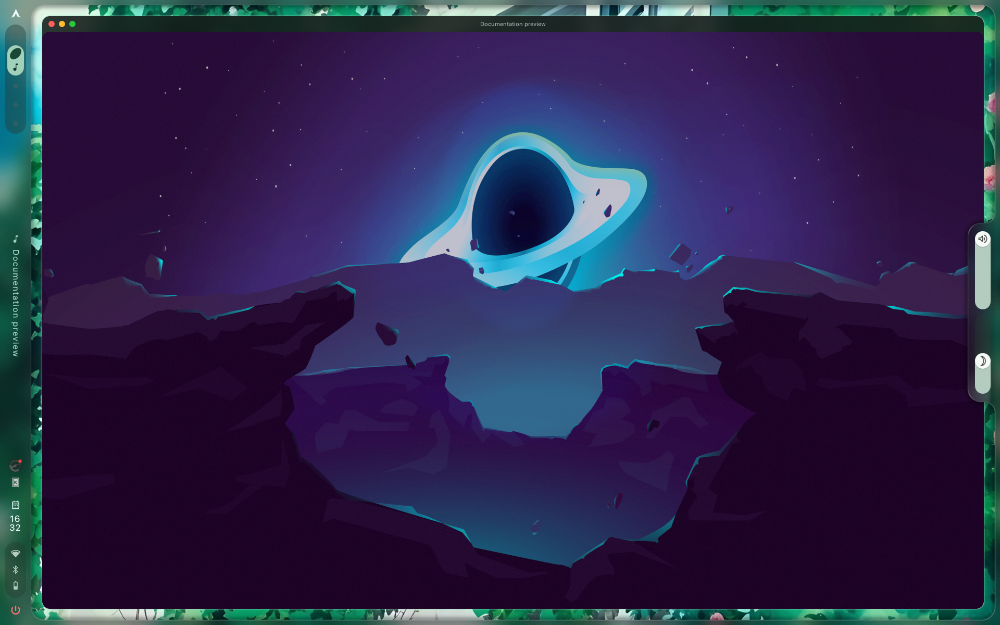
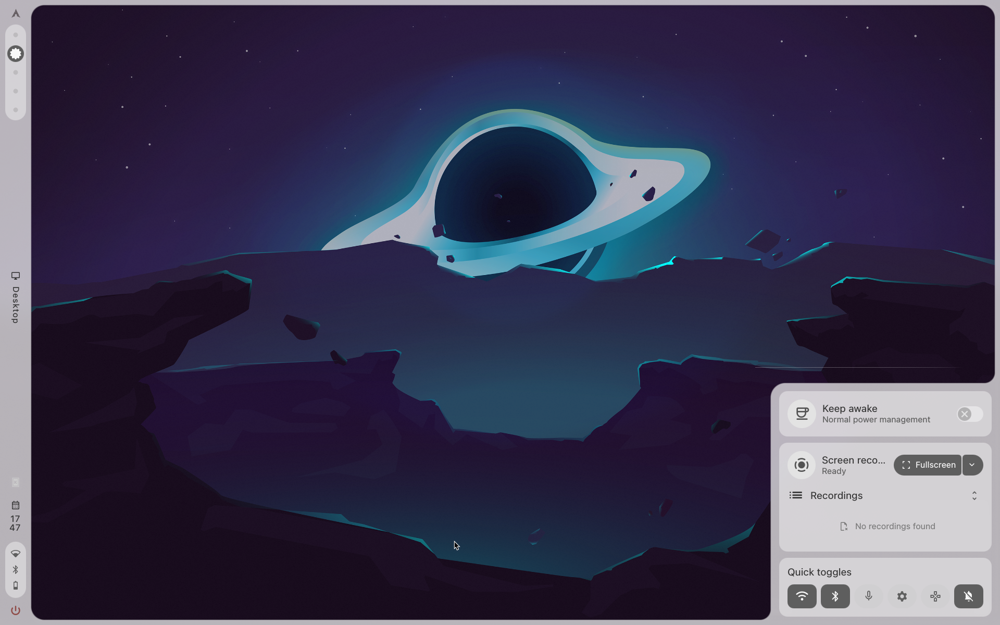
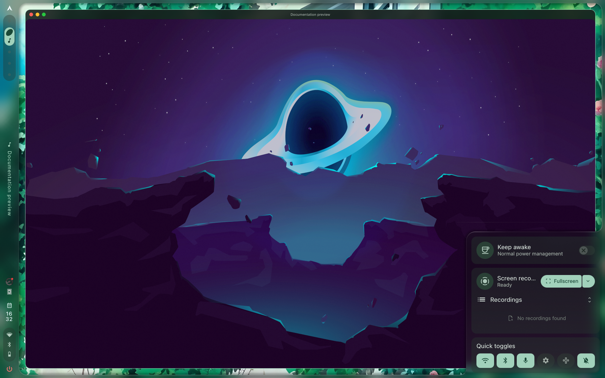
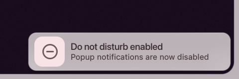
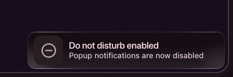
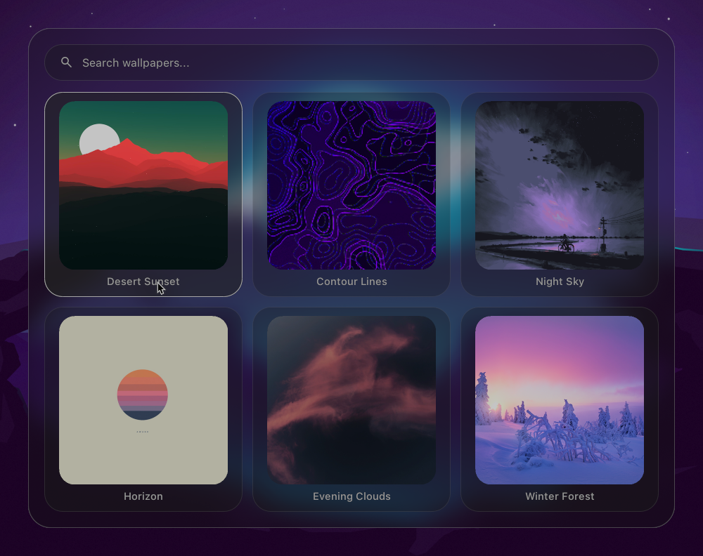
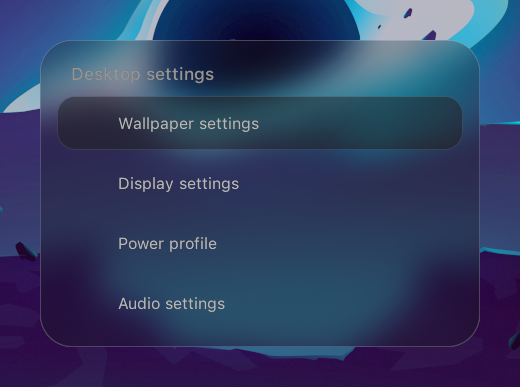

# Caelestia Glass

A community-maintained glass variant of [Caelestia Shell](https://github.com/caelestia-dots/shell) for Hyprland, inspired by macOS.

[](LICENSE)

## Overview

The shell fork applies a translucent material to the screen frame, bar, drawers, popouts, and OSD. A shared signed distance field (SDF) renderer draws connected surfaces with a variable white rim, lower-surface glow, and localized corner highlights. Colors follow the active Caelestia wallpaper palette.

The project also includes an SDDM main view and references to matching Rofi wallpaper picker configuration. The current glass material is experimental and still needs visual refinement.

## Repositories

- [caelestia-glass](https://github.com/FelixStillLearning/caelestia-glass): documentation, installation helper, SDDM main view, and design reference.
- [caelestia-shell, glass branch](https://github.com/FelixStillLearning/caelestia-shell/tree/glass): C++ shader and QML implementation.
- [caelestia-hypr-backup](https://github.com/FelixStillLearning/caelestia-hypr-backup): Hyprland rules, Rofi themes, and wallpaper scripts. Review individual files before applying them to an existing desktop.

This is an independent community variant. It is not an upstream Caelestia release.

## Installation

Read [INSTALL.md](INSTALL.md) before making changes. An existing Hyprland and Caelestia environment is required.

```bash
git clone https://github.com/FelixStillLearning/caelestia-glass.git
mkdir -p "$HOME/.local/src"
git clone -b glass https://github.com/FelixStillLearning/caelestia-shell.git "$HOME/.local/src/caelestia-shell"
cd caelestia-glass
./setup.sh
```

The helper builds an existing fork checkout and links it into the Quickshell configuration. It does not install system packages, clone the fork, or install the Rofi and SDDM components. Back up any existing `~/.config/quickshell/caelestia` configuration first.

The development environment used Hyprland 0.57, Qt 6.12, CMake, Ninja, a C++ compiler, Rofi, FFmpeg, Python, and Pillow. Fonts used include SF Pro and Material Symbols Rounded; obtain fonts separately under their respective licenses.

## Preview

All shell previews were captured on an isolated workspace with a controlled artwork background and notifications suppressed. Light and dark appearances were switched through the actual theme settings. Popup previews use a safe demonstration message; Rofi previews use demonstration entries. No private notifications, account panels, or application windows are shown.

| Light appearance | Dark appearance |
| --- | --- |
|  |  |
|  |  |
|  |  |
|  |  |





## Implementation and validation

- A unified renderer avoids overlapping tint and gaps where glass panels meet.
- Text-bearing shell surfaces use a regular glass tint with semantic foreground colors in both light and dark appearances.
- Light glass uses a thin contour for separation over white and a soft shadow below. Dark frames avoid a surrounding dark halo.
- System toasts share the glass renderer and preserve colored status badges. Disabling transparency restores the opaque presentation.
- The shell fork includes render tests for shadows, frame edges, panel intersections, and popout transitions.
- The Rofi picker uses rounded 480×480 thumbnails displayed in 240 px cards.
- The SDDM file is an adapted main view, not a complete standalone SDDM theme.

A short measurement on one device reached approximately 60 FPS for popup and multi-panel scenarios, with 5.1–11.6% shell graphics engine utilization. Repeated launcher/dashboard switching reached 57.45 FPS and showed frame interval spikes. These results do not establish performance on other systems. See the [performance report](reports/performance-2026-11-15.md).

See the [development log](docs/DEVELOPMENT_LOG.md) for implementation details and validation limits.

## License and attribution

Licensed under [GNU GPL v3.0](LICENSE). Based on Caelestia Shell by the Caelestia team.
